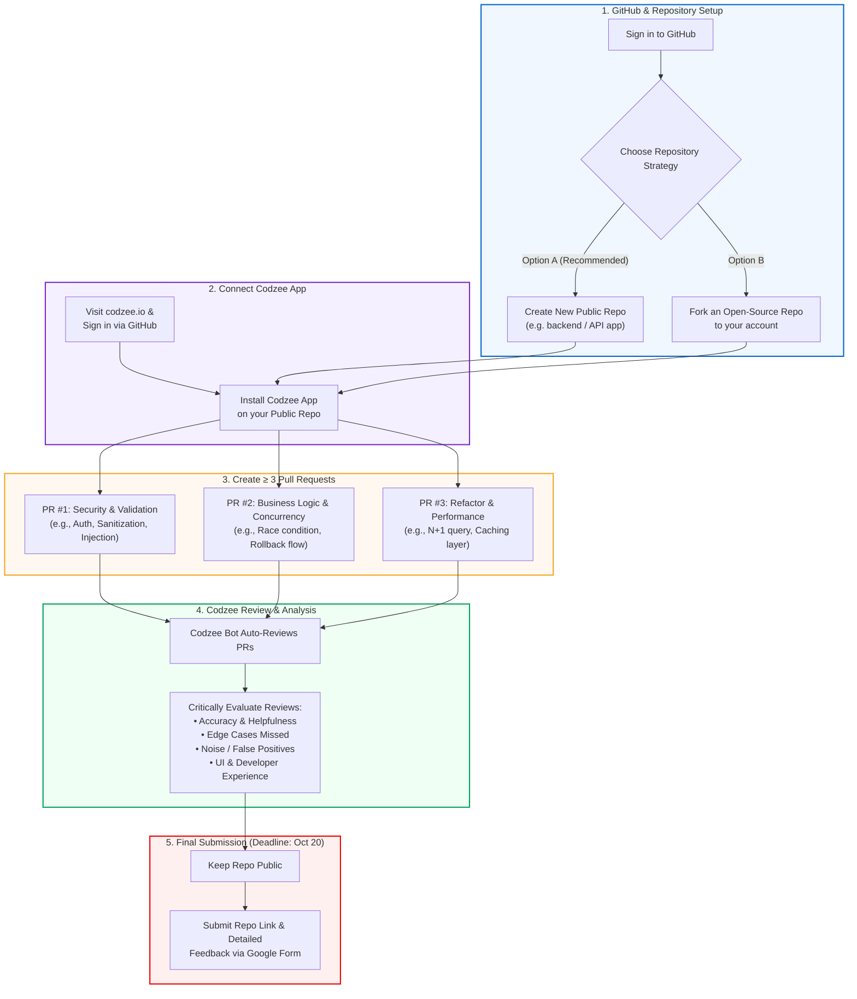

# Codzee First-Round Evaluation — Summary & Action Plan

**Candidate:** Jinson Joseph  
**Company:** Codzee ([www.codzee.io](https://www.codzee.io/))  
**Round:** Round 1 Developer Evaluation (Ownership & Product Experience)  
**Submission Deadline:** Tuesday, 20th October 2026  

---

## 📌 Executive Summary

Codzee has shortlisted you for the first round of interviews. Because **ownership** is a core value and you will be working closely with their core technical team, they want you to experience Codzee directly from a developer’s perspective.

Your task is to set up a public repository, install Codzee, create at least 3 non-trivial pull requests, evaluate Codzee’s code review capabilities, and share critical, constructive feedback via their Google Form.

---

## 🗺️ Visual Workflow Diagram

---

## 📋 Required Steps

### 1. GitHub Account & Setup
* Sign in to [GitHub](https://github.com/).

### 2. Repository Setup
* Create a **new repository** or **fork an open-source project**.
* Ensure the project has sufficient scope and complexity to allow meaningful code changes.
* **Important:** Keep the repository **public** so the Codzee team can review your pull requests and reviews.

### 3. Connect Codzee
* Go to [Codzee.io](https://www.codzee.io/) and log in using your GitHub account.
* Install and authorize Codzee for your newly created/forked repository.
* Confirm that Codzee is active and ready to review incoming pull requests.

### 4. Create Pull Requests (Minimum: 3 PRs)
* Create at least **3 distinct, non-trivial PRs**.
* You may use AI assistance.
* **Requirements:**
  * Do **not** submit empty, cosmetic, or purely trivial changes.
  * Diversify the changes across the PRs (e.g., bug fixes, feature additions, refactoring, security, edge cases) to test Codzee across different dimensions.

### 5. Review & Evaluate Codzee
Observe and critically evaluate the feedback generated by Codzee on each PR across the following questions:
* **Strengths:** What did you like? What worked particularly well?
* **Areas for Improvement:** What could be improved?
* **Bugs & Edge Cases:** Did you notice any bugs, inconsistencies, or confusing behavior? Did it miss anything critical?
* **Accuracy & Value:** Were the reviews accurate, relevant, and actionable?
* **Product Vision:** What features or DX (Developer Experience) improvements would you suggest?

### 6. Submission
* Submit your public repo link and feedback via the provided Google Form before the deadline.

---

## 🎯 What Codzee is Evaluating

1. **Ownership Mindset:** Proactivity, technical diligence, and product empathy.
2. **Critical Thinking:** Ability to identify bugs, blind spots, edge cases, and limitations of AI code reviews.
3. **Engineering Depth:** Quality and realism of the code changes submitted across the PRs.
4. **Product / UX Sense:** Constructive ideas for improving developer workflows and the review experience.
